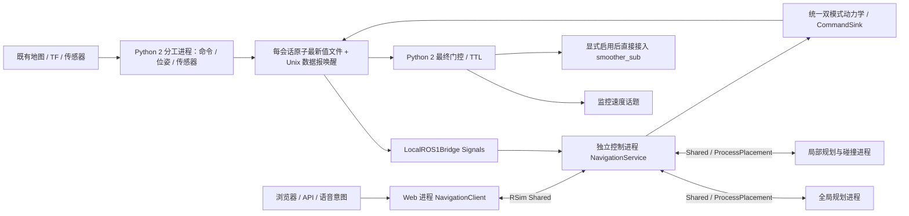

# ROS1 本地控制、双模式导航与网页

2026-10-26 更新：手动自动停障使用制动距离速度搜索，全局导航调用pyrobo并保留受阻路径前段。部署、延迟和实机验证见[制动限速与全局导航](robot-hih-governor-2026-10-26.md)。

ROBOT-HIH 实机最新尺寸与权限见 `PROJECT_HIH.md`：收回500×540mm、余量30mm，伸出/未知暂用原1080×540mm；前后沿由配置 `pedal_shapes` 和CAN反馈共同决定。开发者控制模式支持独占立即接管与多页面共享。下文示例默认几何不代表该实机最新标定。

这一实现把 ROS1 原生节点留在系统 Python 2 中，由现代 Python 的 RSim 管理其生命周期。复用既有地图、定位和传感器；导航与手动驾驶由 RSim 仲裁、规划并直接接入 `/cmd_vel/smoother_sub`。不调用旧网页 goto、move_base 或 joy_pub。默认零速部署只发监控话题，默认要求独占底盘速度话题；ROBOT-HIH 按现场授权允许已知 `/twist_mux` 共存并持续警告，未知发布者仍阻断。

## 环境与启动

需要 Python ≥3.12、numpy、scipy、FastAPI、uvicorn 的 WebSocket 支持、Pillow、threadpoolctl，以及项目使用的 **pyrobo 和 graphmap 源码库**。不要用名字相同的陌生 PyPI 包替代这些库。绘图验证另用 scipykit；ROS 子进程需要系统 Python 2.7、rospy、tf 和配置中所有消息包。

从完整源码 checkout 运行（包括 `compat/`）；当前本地桥接不支持只有 wheel 的安装。参考 `examples/ros1_towing.json`，复制成自己的配置，填写 ROS setup/overlay、话题类型、TF frame 和允许访问的 Host。Shared 进程通信还需要 CycloneDDS 和真正的共享内存目录。配置中的尺寸、CAN 协议和数值只对应示例平台。

```bash
# 默认零速：不会向既有硬件速度话题发布消息
python -m rsim.apps.navigation --config <config.json> --host 127.0.0.1 --port 18780

# 完全不加载 ROS 的仿真
python -m rsim.apps.navigation --config <config.json> --simulate --port 18781
```

默认首次启动生成 `assets/navigation/control.token`，权限 0600。输入网页登录框，或通过 `Authorization: Bearer <token>` 调 API；不要放在 URL。传入 `--no-auth` 可停用网页、HTTP API 和 WebSocket 的令牌认证，网页直接加载；此模式不读取或生成令牌文件，与 `--token-file` 互斥。ROBOT-HIH 当前按用户授权使用 `--no-auth`。`/api/health` 中的 `auth_required` 表示当前认证状态。

停用令牌后，能连接服务的客户端均可使用接口；控制租约、Origin 检查和零速模式仍独立生效。退出服务会停止并回收 Python 2 子进程。不修改现有启动脚本或 Supervisor，不自动设置开机启动。

真实运动需要启动时显式 `--enable-motion`，随后取得控制权并在网页中使能。零速模式不可通过 HTTP 请求切换为真实运动模式。它允许规划预览，但底层实际发布仍为零。

## 数据与生命周期



`LocalROS1Bridge(config, directory=..., python=..., setup=...)` 是普通 Component。`bridge.velocity` 是 `CommandSink[VelocityCommand]`。启动入口默认使用 SharedProvider 隔离控制进程、ProcessPlacement 分别安置全局和局部规划。Web 只消费状态、地图、路径 Signal，并通过 requests 端口请求操作。现代 ROS 适配层位于控制进程；`ros.split_processes=true` 时原生 ROS 分为 command、pose、sensors 三个 Python 2 子进程；未配置时仍支持 combined。命令进程独占硬件速度发布与 CAN 门控，位姿与传感器进程各自持有 TF 监听器，单个扫描等待 TF 不阻塞其他传感器。ROS 解释器不导入现代 RSim 包。

规划结果包含任务代次、地图版本、输入时间与作业 ID；旧任务的结果和错误都不能影响较新的手动任务。全局提交/收件确认与计算均不占用局部控制路径，投递任务有界并在服务关闭时回收。局部投递/输入过期或结果超时均输出零，后续用新快照重试，不延长数据有效期。状态中 queue_ms 是等待开始计算的耗时，compute_ms 是计算耗时，loop_ms 包含控制与通信；last_stop 保留最近停车原因。Web RPC 租约 1 s 与底层速度 TTL .25 s 是不同边界。

会话目录为 `/dev/shm/rsim-ros1/<uuid>/`。文件通过临时文件和原子重命名交换最新值；消息包含版本、会话、序号、ROS 时间、接收单调时间。大数值数组复用 ROS1 适配器的 base64 编码。这是本地协议，不是假装成既有 DDS/mmap wire format。目录含 `agent-command.log`、`agent-pose.log`、`agent-sensors.log`（combined 模式为 `agent-combined.log`）和消息快照，可排查跨解释器问题；旧会话不会被重用。停止后可按会话清理历史目录。PRoot 是否把 `/dev/shm` 绑定到磁盘目录，应在设备上核实。

ROBOT-HIH 当前将新的 PRoot `/dev/shm` 绑定到 Android `/mnt/iso/rsim-shm` 的真实 tmpfs（禁止恢复曾导致 Android 应用启动故障的 `/mnt/expand` 路径），并重建 RSim 的 tmux server。旧 PRoot 会话仍保留原绑定，须退出重进；单纯连接旧 tmux server 不会改变它的文件系统视图。共享映射、硬链接复用、跨进程、CycloneDDS 和 Python 2/3 原子消息交换已验证。目录由宿主入口检查并在重启后重建；不持久化地图业务文件，不代替持久日志目录。具体启动及回退见设备文档项目的 `docs/rsim-tmpfs.md`。

桥接仅订阅配置声明的话题；控制端单独写带序号、控制 epoch 和到期时间的命令。命令提交后立即用 Linux abstract Unix 数据报唤醒原生门控，20 ms 轮询保留为看门狗后备；原生进程检查命令与主人心跳，心跳超过 1 s 便退出；命令 TTL 不超过 .5 s，应用实际使用 .25 s。进程锁避免本桥接的重复实例，速度话题锁只能协调遵守相同约定的 RSim 实例，不能锁住厂商节点。

## 模型、路径和障碍

导航、遥控、预测和制动共用力驱动模型：驱动力减固定摩擦及速度平方阻力，再按软件加速度约束积分。线速度硬上限 1.6 m/s；默认线性无约束平衡速度约 1.915 m/s，角向约 1.014 rad/s、硬上限 .8 rad/s。牵引模式限制前进、最小转弯半径及后部横向速度 `abs(w) * rear_extent`；制动时保留必要前进速度直至转动衰减。差速模式允许倒车、原地转向和到点后调整朝向。硬件故障、过期或停止指令直接要求零速度，实际减速仍受底盘控制器影响。

运动模式与踏板外形相互独立；两种模式 × 两种外形分别验证。有效手动命令总是覆盖导航和语音目标；手动期间的新 goal/resume 只能保留任务，松手减速完成后任务暂停，不自动恢复。模式切换要求实际速度接近零。厂商任务状态、TEB 限速与上层速度话题不参与 RSim 控制权门控；硬件联锁、传感器/TF 新鲜度、TTL 和相同硬件输出话题的多发布者冲突仍会阻断。

示例车宽 .54 m，前沿 +.27 m，收起踏板后沿 -.27 m，伸出后沿 -.81 m，旋转中心不随踏板改变。碰撞矩形按真实偏心位置计算，额外边距 .10 m。踏板收起不自动缩短被牵引人的参考距离，默认仍按 .81 m 限制后部横向速度 .12 m/s。这些舒适性参数需要现场标定。

优先搜索前进圆弧/直线连接；遇障碍后使用 pyrobo RRTConnect（可选 Voronoi）生成全局路线，再转成可前进的曲线。DWA 在动态可达速度窗口内预测同一模型，检查整个车体、采样间扫掠以及制动尾段。动态雷达点保留完整密度参与避障；仅网页显示抽样。地图未知单元和图外不可通行，传感器使用采样时刻 TF。找不到当前模式的可行路径、数据失效或计算超时时输出零；牵引模式不自动退车或原地硬转。

这不是完备的非完整约束规划器：几何上存在路径也可能搜索失败，届时保持停止并报告原因。导航阻挡仍暂停任务。手动 blocked 保持零速和使能许可，须继续有新鲜按住输入且新轨迹通过碰撞检查才能恢复；输入超时、硬件/数据故障仍解除使能。二维碰撞检查依赖已有深度扫描转换，未提供全高度三维人体/车体安全认证。

## 网页和网络接口

网页提供浏览/导航/位置校正/标点四种地图操作，支持平移、滚轮与双指缩放，栅格底图使用最近邻显示；同时显示 RSim 全局路径、局部轨迹和碰撞外形。可读取原厂地图和位置，也可在独立 RSim 文件中新增、改名、删除自建点位。历史地图只能浏览，发送目标前校验当前地图身份与坐标。松开遥控按所选行为减速至停车并保留使能；当前驾驶页失焦、隐藏、断线或租约过期停车解除使能。共享的非当前驾驶页失焦/断线不停止其他驾驶页。默认普通模式：状态每 200 ms、可视化每 250 ms，使用独立定时器。地图默认开启；运动通道与地图/扫描 HTTP 请求分开，驾驶输入每 80 ms，手动开启低带宽后状态每 2 s、可视化每 2.5 s。它不能替代网络层 QoS，也不保证公网延迟。

| 接口 | 用途 |
| --- | --- |
| `POST /api/session` | 默认令牌登录，HttpOnly、SameSite Cookie；`--no-auth` 时直接成功且不设置 Cookie |
| `GET /api/health` | 无需登录的模式/进程健康摘要 |
| `GET /api/status?compact=true` | 小型状态、门控原因、实际/预览速度 |
| `GET /api/clock` | 服务端单调时钟（毫秒） |
| `POST /api/claim` | 按开发者 exclusive/shared 设置取得控制租约 |
| `WS /ws/control`、`POST /api/control` | heartbeat、idle、arm、manual、goal、pause、resume、stop、cancel、manual_collision、footprint、drive_mode、speeds |
| `GET /api/map/meta`、`/api/map.png`、`/api/visual` | 元数据、带 ETag 的 PNG、有限显示点数 |
| `GET/POST /api/waypoints` | 原厂地图点位及本应用新增位置，支持自建点位改名/删除 |
| `POST /api/localization` | 通过原 ROS `/initialpose` 重定位，默认禁止写入 |
| `GET /api/mapping`、`POST /api/mapping/{start,save,cancel}` | 直接调用厂商 8088 的 mapping_*，写入默认关闭；不依赖 18765 |

所有控制包（含停止/暂停/取消）需有效 `lease` 与该租约内递增整数 `sequence`；除停止/暂停/取消外，还需服务端单调时钟下的 `deadline_ms`。手动/使能/心跳到期上限 500 ms，目标/踏板上限 2000 ms；租约 .8 s，手动死手开关 .25 s。WebSocket hello/ack 含时钟，可用于估算偏移；新序号不能让旧到期包复活。

`manual_collision` 的 `collision_check` 开关只影响手动驾驶：关闭时跳过地图/扫描/规划 IPC，保留速度与动力学限制、急停、碰撞开关、CAN 踏板、租约与命令到期。切换会停车并解除使能；重启默认恢复开启，导航始终检查障碍。

`manual` 的 `input_source` 可为 `keys`（默认）或 `joystick`。速度目标摇杆允许连续跨零到倒车；按键反向先刹停，释放再按可倒车，零速附近 ±0.03 m/s 轮速噪声不锁死新按键。`manual` 参数 `throttle` 为 [-1,1]（两种模式均支持手动受控倒车），`steering` 为 [-1,1]；`goal` 使用地图坐标 x/y（米）、yaw（弧度）。启用令牌认证时所有控制操作均需鉴权。独占模式下新的 claim 立即撤销旧租约并停车解除使能；共享模式允许所有有效租约发命令，各自维护序号与期限。旧页停止或断线不能影响新控制端。

`manual.input_active` 为严格布尔值，默认 true。摇杆按住时（包括位于死区）传 true；松手自动回中传 false 且两轴必须为 0。`manual.<drive_mode>.release_mode` 独立于轴绑定：coast（默认）在松手后模拟零驱动力滑行，手仍按着回中则跟踪零速度；target_zero 在两种回中情况下都跟踪零速度。设置保存立即生效，旧持久设置迁移为 coast，旧页面需刷新。速度绝对值下降受减速度上限约束，空挡实际减速按摩擦与平方阻力计算；不会切断电机使能。松手减速期间本页有效心跳维持租约；按住输入（包括在死区内）仍须每 250 ms 内续新输入，心跳不能代替。显式 stop、失联和硬件联锁仍立即发零。

局域网访问可绑定 `0.0.0.0` 并列出精确 `allowed_hosts`；公网使用 VPN、SSH 隧道或 TLS。服务支持 `--ssl-certfile` / `--ssl-keyfile`，以及支持 WebSocket 的同源反向代理；转发时保留 Host 和协议，关闭控制请求缓存。不要把明文令牌 HTTP 直接暴露到公网。此项目不自动修改路由器、防火墙、DNS 或证书。

## 保留原建图与定位

先确认正在运行的定位系统：已安装 Cartographer 不代表当前定位一定由它提供。应用只消费配置地图 frame 的 TF 和 `/map`，可兼容原 AMCL/ICP 或 Cartographer 输出。需要定位写入时设置 `ros.allow_localization`；需要建图操作时配置 `catalog.vendor_url` 与凭据配置路径，并设置 `allow_mapping`。建图仅发 mapping_start/save/cancel，start 固定 exploration=false，不自动调用旧导航取消或探索。地图预览复用实时 /map。这些开关不改变运动零速门，但建图会切换原系统任务，因此默认关闭，不能用作只读健康探测。

## 验证

```bash
python -m pytest -q tests/test_ros1_local.py tests/test_towing_navigation.py \
  tests/test_navigation_web.py tests/test_navigation_auxiliary.py tests/test_navigation_modes.py \
  tests/test_navigation_catalog.py tests/test_navigation_processes.py tests/test_vehicle_control.py
python -m tools.validate_towing --plot
```

仿真验证两种外形的 180° 前进掉头、墙体绕行、制动尾段及后部横向速度。测试还覆盖未知区域、阻塞不原地转、鉴权/Origin、控制竞争、旧指令拒绝、断线停车和停止后丢弃迟到规划结果。生成的指标、CSV 和图保存在 `assets/towing-validation/`。这些结果不替代真实底盘制动距离、牵引舒适性、碰撞传感器和多发布者仲裁的现场验收。

## 平台辅助功能与迁移边界

- `GET /api/battery`、`/api/handles`、`/api/speed` 及状态中的 telemetry 直接来自 ROS 订阅。每项附接收年龄和 fresh 标记，未接收保持未知。
- `GET/POST /api/speeds` 调整导航、手动和角速度目标上限；修改时停车，保存到 RSim data-dir 的 speed-settings.json。把手左慢行、右侧提高导航目标，上限始终 1.6 m/s；目标在动力学与碰撞预测之前调整，不缩放已经检查过的速度输出。
- `POST /api/pushrod` 使用 GuideRobot 的 can1 节点 4 协议，固定两次发送；不采用已知可能假成功的 ROS 后备服务。默认 allow_pedal=false。动作发送不是到位反馈，收回和失败均继续按 .81 m 后沿检查，确认实物位置后才能缩小外形。运动模式保持独立。
- `GET /api/assistant/status`、`POST /api/assistant/{text,once,start,stop}`、`POST /api/voice/{volume,announce}` 使用受 RSim 管理的 Python 3 音频子进程，按需读取已安装的 voice.py/assistant.py。不导入旧 server.py，不启动 handle_scale.py。旧助手 HTTP 导航函数被禁用，识别结果走父进程意图通道，必须持有仍有效的控制租约，不能自动 claim 或 arm。断线停止持续监听。音量配置写入 RSim 自己的 data-dir，不覆盖旧软件设置。allow_audio=false 时文字解析仍可用，不录音、不播音。
- `GET /api/dispatch/{locations,status,map/current,map/image}` 与 `POST /api/dispatch/{goto,pause,resume,cancel}` 使用 RSim 的相同任务入口。goto 可提供 loc_uuid 或坐标。运动请求仍需 lease、sequence、deadline_ms；这不是旧调度器的无租约协议兼容承诺。所有接口在 RSim Web 端口，不另外占用 18770。
- 取消/暂停/停止不要求当前控制租约，但仍遵守应用认证及 Origin 规则。辅助写请求必须带租约、序号和到期时间。建图响应超时保留 unknown，不自动重试或声称已保存。

原厂数据库保持只读，新点位单独保存；Android 浏览器隐藏/旧调度器自动重发/旧遥控代理重启不迁移。音频、推杆、地图保存、真实重定位与真实行走的端到端硬件效果需单独现场验收；仿真和接口测试不证明这些硬件动作已经执行。

## 2026-10-26 实机数据通路补充

桥接限频保留最新待发送帧，并在到期时发送；不再要求“本帧距上次接收至少一个周期”而造成隔帧。通知驱动读取，2 Hz 文件扫描仅用于通知丢失恢复和子进程故障检查；两路读取共用锁，防止旧快照后到。PRoot 下路径 Unix socket 的 sendto 地址未被正确翻译，已使用会话唯一的 abstract 地址。原子文件仍承载数据，通知只负责唤醒。该方案不是零复制；DDS 底层仍有轮询。

`status.bridge_timing` 提供各数据端口 sequence、源接收至写入的 write_ms、写入至 RSim 读取的 read_ms、数据 age_ms。`Component.task(hz=None)` 用于内部等待事件的回调；端口收发、命令收发和规划待办均用事件唤醒。Metronome 超过期限后立即执行最新一拍，不再额外等到下一整拍。

ROBOT-HIH 收回车身在 `base_footprint` 中为前沿 +0.10 m、后沿 −0.40 m、宽 0.54 m、外加 0.03 m 碰撞余量；基座原点不是矩形中心。伸出/未知仍使用原 +0.27/−0.81 m，等待重新测量。主雷达 TF 为 [−0.147, 0, 0.16]。`scan_body_filters` 过滤标定车壳内回波；`scan_self_filters.scan.near_speckle_range=.6` 对近场一两束孤立点去噪，要求至少三束在相邻 ±3 束、25 mm 内互相支持；`edge_echo_masks` 只覆盖已确认的两个后侧遮罩边缘近回波。成簇和范围外障碍保留。

底部原厂二维扫描丢失了高度，现场发现 1.4–3.3 cm 地面残点误报为前方障碍。RSim 的 scan_bottom 改订阅原有 points_no_ground 三维点云，先按采样时刻 TF 转到 base_footprint，保留 0.05–2.0 m 高度、0.1–2.0 m 距离，再投影为 1° 扫描。只改 RSim 配置，不改原厂 ROS 参数；5 cm 以下低矮物体不由这条深度投影保证检测。投影失败产生无效扫描并停车，合法空云允许空障碍集。

旧 18765 服务现为手动启动：Android 桌面“手拉手（手动）”→RSim `/legacy`；取得租约后通过 `/api/legacy/start` 或 `/api/legacy/stop` 管理仅 onboard-nav 及明确识别的旧 helper 进程。启动前取消 RSim 运动；启动旧服务后仍可能产生速度/限速冲突，页面会提示。详见设备文档项目 `docs/rsim-pipeline-2026-10-26.md`。


ROBOT-HIH 的上下深度源配置 `depth_filter: {frame: <对应相机 optical_frame>, max_depth: 0.7}`，与 PointCloud2 的 `projection` 一起使用。先对采样点在相机光学坐标中的 Z 深度做 `0 < Z <= 0.7 m` 裁剪，再转换到基座做高度过滤和二维障碍投影。消息本身已在基座坐标时，先逆变换求相机深度；不能用最终扫描的基座距离替代这一门限。没有增加置信度、邻域或跨帧筛选。metadata.depth_filter 记录源点数、保留点数和最大保留深度，空保留集合法，变换或配置错误不当成无障碍。深度点只形成即时障碍，不更新地图或定位。
